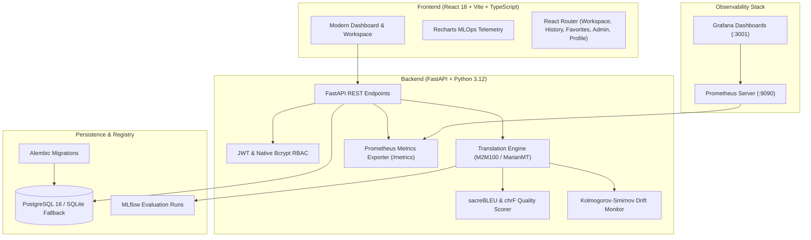

# Language Translation System with MLOps Monitoring

A complete, production-grade academic project implementing Neural Machine Translation (NMT) across Indic and global languages (English, Hindi, Telugu, Tamil, and more) with automated MLOps monitoring, telemetry, BLEU/chrF evaluation, and data drift detection.

---

## 🏛️ System Architecture



---

## 🛠️ Technology Stack

- **Frontend:** React 18, Vite, TypeScript, Tailwind CSS, React Router v6, Recharts, Lucide React, Vitest.
- **Backend:** Python 3.12, FastAPI, Pydantic v2, SQLAlchemy 2.0, Alembic, Native Bcrypt, Python-Jose (JWT), Pytest.
- **Machine Learning & MLOps:** Hugging Face Transformers, sacreBLEU, Scipy (Two-Sample Kolmogorov-Smirnov test), Prometheus Client, MLflow tracking.
- **Infrastructure:** Docker, Docker Compose, Nginx, PostgreSQL 16, Prometheus, Grafana, GitHub Actions CI.

---

## 🚀 Quick Start Guide

### 1. Prerequisites
- **Node.js:** v18+ (tested on v22)
- **Python:** 3.12+
- **Docker & Docker Compose** (Optional for containerized run)

### 2. Local Setup & Execution

#### Option A: Running with Docker Compose (Full Stack)
```bash
# 1. Copy environment template
cp .env.example .env

# 2. Build and start all services
docker compose up -d --build
```
- **Frontend Application:** [http://localhost:3000](http://localhost:3000)
- **FastAPI Documentation:** [http://localhost:8000/docs](http://localhost:8000/docs)
- **Prometheus Metrics:** [http://localhost:8000/metrics](http://localhost:8000/metrics)
- **Prometheus Server:** [http://localhost:9090](http://localhost:9090)
- **Grafana Dashboard:** [http://localhost:3001](http://localhost:3001) (User: `admin` / Password: `admin2026`)

---

#### Option B: Native Local Development

##### 1. Backend Setup
```bash
# Activate virtual environment
# Windows:
.\venv\Scripts\activate
# Linux/macOS:
source venv/bin/activate

# Install requirements
pip install -r backend/requirements.txt

# Run database migrations
alembic upgrade head

# Start FastAPI server
uvicorn backend.app.main:app --host 0.0.0.0 --port 8000 --reload
```

##### 2. Frontend Setup
```bash
# In the project root:
npm install

# Start Vite development server
npm run dev
```
Open **[http://localhost:3000](http://localhost:3000)** in your browser.

---

## 🔑 Demo Authentication Credentials

The system comes pre-seeded with two secure demonstration accounts:

| Role | Email Address | Password | Permissions |
| :--- | :--- | :--- | :--- |
| **Admin** | `admin@translateml.edu` | `AdminSecret2026!` | Full administrative access, model promotion, rollback, user management, audit logs |
| **User** | `researcher@translateml.edu` | `UserSecret2026!` | Translation workspace, history, favorites, personal profile |

*(One-click quick login buttons for both roles are also available directly on the login screen).*

---

## 🧪 Testing and Verification

### Frontend Test Suite (Vitest)
```bash
npm test
```
*Executes unit tests for language pair validation, translation simulator, and telemetry.*

### Backend Test Suite (Pytest)
```bash
.\venv\Scripts\pytest.exe -v
```
*Executes 10 automated test cases verifying health checks, Prometheus `/metrics`, JWT authentication, RBAC authorization, translation endpoints for English/Hindi/Telugu/Tamil, error handling, and Kolmogorov-Smirnov drift monitoring.*

### Production Build Verification
```bash
npm run build
```

---

## 📊 MLOps Features

1. **Prometheus Telemetry:** Exposes `/metrics` scraping endpoint tracking:
   - `translation_requests_total`: Request volume categorized by status, language pair, and model.
   - `translation_latency_seconds`: Latency histogram with p50, p95, and p99 percentiles.
   - `model_bleu_score` & `model_chrf_score`: Continuous benchmark metrics.
   - `data_drift_p_value`: Distribution drift indicator.

2. **Automated Data Drift Detection:**
   - Evaluates empirical distribution of live request tokens against baseline using the two-sample Kolmogorov-Smirnov test ($p < 0.05$ flags drift).

3. **Continuous Evaluation:**
   - Real-time sentence evaluation using `sacrebleu` against benchmark datasets for English, Hindi, Telugu, and Tamil.

4. **Model Promotion & Rollback:**
   - Admin console allows zero-downtime switching and rollback between model checkpoints (e.g., `M2M100-Indic-v2.1` vs `MarianMT-Indic-v1.5`).

---

## 📑 Academic Documentation
- [Comprehensive Academic Report & Diagrams](file:///c:/Users/pavan/Documents/antigravity/mysterious-noether/docs/ACADEMIC_REPORT.md)
