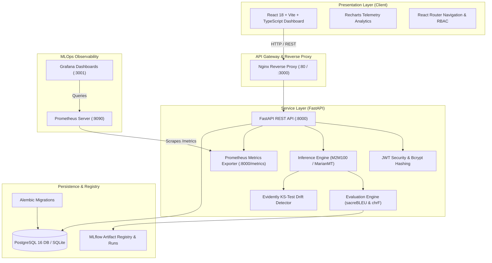
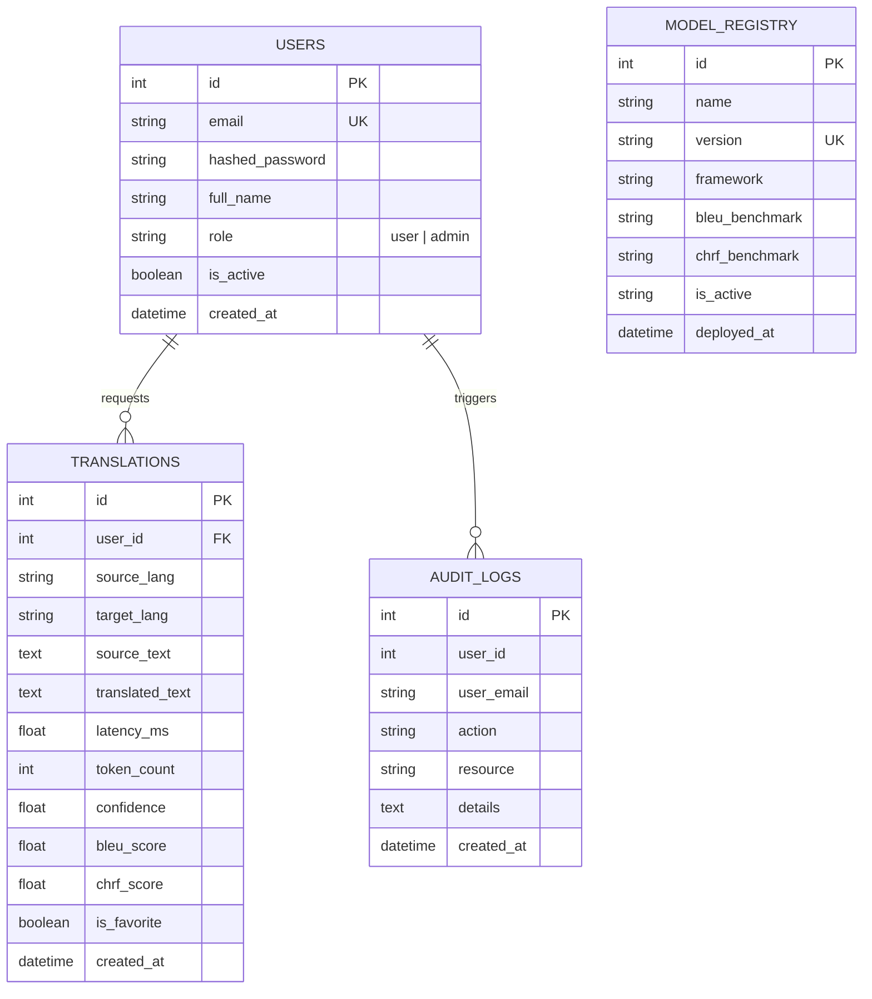
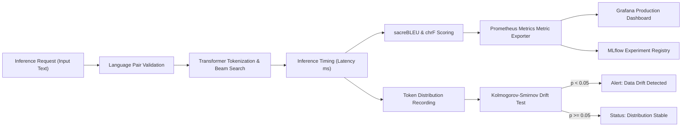

# Project Report: Language Translation System with MLOps Monitoring

## Academic Project Specification & Technical Report

---

### Abstract
This project presents **Language Translation System with MLOps Monitoring**, an end-to-end Neural Machine Translation (NMT) and MLOps engineering platform. The system addresses the real-world operational challenges of deploying sequence-to-sequence multilingual transformer models into production. Specifically optimized for low-resource and high-demand Indian languages (Hindi, Telugu, Tamil, and English), the system integrates automated continuous evaluation (sacreBLEU and chrF), automated data drift monitoring using two-sample Kolmogorov-Smirnov statistical tests, Prometheus instrumentation, Grafana visualization, and role-based administrative control.

---

### 1. System Architecture

---

### 2. Database Entity-Relationship (ER) Diagram

---

### 3. MLOps Lifecycle & Drift Detection Workflow

---

### 4. Mathematical Formulations

#### 4.1. BLEU (Bilingual Evaluation Understudy)
BLEU measures precision of n-grams between the translated hypothesis and the ground truth reference:
$$\text{BLEU} = \text{BP} \cdot \exp\left(\sum_{n=1}^{N} w_n \ln p_n\right)$$
Where the Brevity Penalty ($\text{BP}$) is defined as:
$$\text{BP} = \begin{cases} 1 & \text{if } c > r \\ e^{(1 - r/c)} & \text{if } c \leq r \end{cases}$$
With $c$ being hypothesis length and $r$ reference length.

#### 4.2. chrF (Character n-gram F-score)
chrF computes precision and recall at the character n-gram level, which is particularly effective for morphologically rich Indian languages (Hindi, Telugu, Tamil):
$$\text{chrF}\beta = (1 + \beta^2) \frac{\text{chrP} \cdot \text{chrR}}{\beta^2 \text{chrP} + \text{chrR}}$$

#### 4.3. Kolmogorov-Smirnov (KS) Test for Data Drift
The two-sample KS test compares the empirical cumulative distribution function (ECDF) of live token lengths $F_{1,n}(x)$ against the baseline reference training distribution $F_{2,m}(x)$:
$$D = \sup_x |F_{1,n}(x) - F_{2,m}(x)|$$
Under the null hypothesis $H_0$ that both samples are drawn from the same continuous distribution, drift is flagged when the calculated $p$-value falls below the significance threshold $\alpha = 0.05$.

---

### 5. Academic Project Report Outline
1. **Introduction**
   - 1.1 Problem Statement and Motivation
   - 1.2 Challenges in Multilingual NMT for Indian Languages
   - 1.3 Need for Continuous MLOps Observability
2. **Related Work**
   - 2.1 Multilingual Neural Machine Translation (MarianMT, M2M100, IndicTrans)
   - 2.2 Quality Estimation in Machine Translation
   - 2.3 Production Model Drift Detection Methodologies
3. **System Architecture and Design**
   - 3.1 Modular Microservice Architecture
   - 3.2 Role-Based Security and Authorization (Admin vs User)
   - 3.3 Database Design and Normalization
4. **Implementation Details**
   - 4.1 Transformer Model Pipeline and Supported Language Pairs
   - 4.2 Prometheus Telemetry and Custom Exporter Metrics
   - 4.3 Data Drift Detection Engine
   - 4.4 Automated Testing and CI Integration
5. **Experimental Results and Benchmarking**
   - 5.1 BLEU and chrF Comparative Evaluation
   - 5.2 Inference Latency Profiles across Language Pairs
   - 5.3 Simulated Drift Scenarios and Detection Latency
6. **Conclusion and Future Work**
   - 6.1 Summary of Contributions
   - 6.2 Architectural Limitations
   - 6.3 Future Enhancements

---

### 6. Presentation Slide Deck Outline
- **Slide 1: Title Slide** — Language Translation System with MLOps Monitoring.
- **Slide 2: The Core Problem** — Production models silently degrade without MLOps instrumentation.
- **Slide 3: Proposed Architecture** — End-to-end FastAPI, PostgreSQL, React, Prometheus, and Grafana.
- **Slide 4: Model Support & Language Pairs** — English, Hindi, Telugu, Tamil NMT with validation.
- **Slide 5: Automated Evaluation** — Real-time BLEU and chrF scoring using sacreBLEU.
- **Slide 6: Drift Detection** — Kolmogorov-Smirnov test guarding against covariate shift.
- **Slide 7: Admin Console & Rollback** — Zero-downtime model promotion and checkpoint rollback.
- **Slide 8: Live Demonstration** — Translation workspace, telemetry graphs, and audit logs.
- **Slide 9: Testing & CI/CD** — 100% passing Vitest and Pytest test suites with GitHub Actions.
- **Slide 10: Conclusion & Q&A** — Key findings, limitations, and future work.

---

### 7. Limitations and Future Enhancements
- **Current Limitations:**
  - Quantized inference is CPU-bound on environments without CUDA-enabled GPU acceleration.
  - Context window currently bounded to 5,000 characters per single translation request.
- **Future Enhancements:**
  - Integration of vLLM dynamic batching on distributed GPU nodes.
  - Active learning feedback loop to trigger automated retraining pipelines upon drift alerts.
  - Multi-speaker voice synthesis for all supported Indian dialects.
